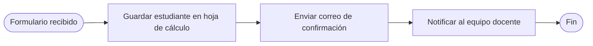

# Pensar antes de programar: flujos de trabajo y diagramas de flujo para principiantes

Antes de escribir una sola línea de código, los desarrolladores con experiencia hacen algo que los principiantes suelen saltarse: **dibujan el problema**. Un buen diagrama convierte una idea difusa en pasos concretos, y esos pasos son la base de cualquier programa.

En esta práctica aprenderás dos habilidades complementarias: visualizar flujos de trabajo con **Excalidraw** y representar la lógica con **diagramas de flujo estándar**.


## ¿Por qué dibujar un flujo?

Un flujo de trabajo describe **qué pasa, en qué orden y quién (o qué) lo hace**. Dibujarlo te permite:

- **Detectar huecos** en la lógica antes de que se conviertan en errores.
- **Comunicarte** con tu equipo (o con una IA) usando un lenguaje visual compartido.
- **Dividir** un problema grande en partes pequeñas y manejables.
- **Documentar** decisiones de forma rápida y entendible.

> Regla práctica: si no puedes dibujar el proceso, probablemente todavía no lo entiendes del todo.


## Excalidraw: pensar en voz alta con dibujos

[Excalidraw](https://excalidraw.com) es una pizarra virtual gratuita, abierta y sin registro, con estética de "boceto a mano". Ese estilo informal es una ventaja pedagógica: invita a **explorar sin miedo a que quede perfecto**.

**Lo básico que necesitas:**

| Herramienta | Para qué sirve |
|---|---|
| Rectángulo / rombo / elipse | Representar pasos, decisiones e inicio/fin |
| Flecha | Indicar la dirección del flujo |
| Texto | Nombrar cada paso con verbos claros |
| Colores y agrupación | Distinguir actores, fases o responsabilidades |

**Consejos para empezar:**

1. Escribe primero el objetivo en una frase, arriba del lienzo.
2. Usa **verbos en infinitivo** en cada paso ("Validar correo", "Guardar usuario").
3. Avanza de izquierda a derecha o de arriba hacia abajo, sin cruzar flechas.
4. Itera: mueve, borra y reorganiza. El primer borrador nunca es el definitivo.


## Diagramas de flujo estándar: un lenguaje común

Los diagramas de flujo usan símbolos convencionales para que cualquier persona los interprete igual. Conocerlos te da precisión.

| Símbolo | Forma | Significado |
|---|---|---|
| Inicio / Fin | Óvalo | Donde comienza o termina el proceso |
| Proceso | Rectángulo | Una acción u operación |
| Decisión | Rombo | Pregunta con respuesta Sí / No |
| Entrada / Salida | Paralelogramo | Datos que entran o salen |
| Flecha | Línea con punta | Orden de ejecución |

### Ejemplo: iniciar sesión en una aplicación


Observa cómo cada **rombo** tiene exactamente dos salidas y cómo el flujo puede **volver atrás** (un bucle) cuando algo falla. Esa es la semilla de un `if` y un `while` en código.


## De la pizarra al código

| En el diagrama | En el código |
|---|---|
| Rectángulo (proceso) | Instrucción o función |
| Rombo (decisión) | `if / else` |
| Flecha que regresa | Bucle (`while`, `for`) |
| Entrada / salida | Variables, `input`, `print` / `console.log` |

Si tu diagrama es claro, **traducirlo a código es casi mecánico**.


## Y si el diagrama se pudiera ejecutar solo: conoce n8n
 
Hasta ahora tus diagramas son **dibujos**: describen un proceso, pero alguien tiene que hacerlo a mano. ¿Qué pasaría si el propio diagrama pudiera ejecutarse?
 
Eso es lo que permite **n8n** (se pronuncia "n-eight-n"): una plataforma de **automatización de flujos de trabajo** que conecta aplicaciones, servicios, bases de datos y APIs para ejecutar tareas automáticamente.
 
### Un problema cotidiano
 
Imagina que cada vez que un estudiante completa un formulario de inscripción debes:
 
1. Leer sus datos.
2. Guardarlos en una hoja de cálculo.
3. Enviarle un correo de confirmación.
4. Notificar al equipo docente.
5. Registrar la fecha de inscripción.
Podrías hacerlo manualmente cada día, o **diseñar un flujo que lo haga por ti**. La idea central es esta:
 
> En lugar de que una persona ejecute una secuencia de tareas, diseñamos un flujo que determina **cuándo** ejecutarlas, **qué información** usar y **qué hacer** con los resultados.
 
Fíjate que ya sabes hacer la mitad del trabajo: es un diagrama de flujo.
 

 
### Los tres elementos de un workflow
 
La unidad fundamental de n8n es el **workflow**: una secuencia de operaciones conectadas entre sí. Se compone de tres piezas, y cada una tiene un equivalente directo en lo que ya aprendiste:
 
| Elemento en n8n | Función | Equivalente en tu diagrama |
|---|---|---|
| **Trigger** (disparador) | Inicia el flujo cuando ocurre un evento | El óvalo de **inicio** |
| **Nodes** (nodos) | Ejecutan una operación concreta | Los **rectángulos** y **rombos** |
| **Connections** (conexiones) | Pasan la información de un nodo al siguiente | Las **flechas** |
 
**Trigger.** Es el sensor de una alarma: detecta que ocurrió algo y activa el proceso. Por ejemplo, recibir un correo, que alguien complete un formulario, que llegue una solicitud HTTP, que sean las 9:00 de cada día o que entre un mensaje de Telegram.
 
**Nodos.** Cada nodo tiene **una responsabilidad concreta**: obtener datos de una API, enviar un correo, consultar una base de datos, transformar información, evaluar una condición, ejecutar código JavaScript o consultar un modelo de inteligencia artificial.
 
**Conexiones.** Cada nodo recibe información, realiza una operación y entrega un resultado que usará el siguiente.
 
### ¿Qué viaja por las flechas? Datos en formato JSON
 
Entender cómo se mueve la información entre nodos es tan importante como saber conectarlos. n8n transporta los datos en formato **JSON**. Por ejemplo, el formulario del estudiante llega así:
 
```json
{
  "nombre": "Ana",
  "email": "ana@email.com",
  "curso": "Data Analytics",
  "edad": 28
}
```
 
Cada nodo posterior puede usar esos campos:
 
- El nodo de hoja de cálculo usa `nombre` para guardar el nombre.
- El nodo de correo usa `email` para saber a quién escribir.
- Un nodo **IF** (el rombo de tu diagrama) puede evaluar si `edad` es mayor o igual a 18.
Para acceder a esos datos se usan **expresiones**:
 
```
{{ $json.nombre }}
{{ $json.email }}
```
 
`$json` significa "el JSON del elemento actual". También puedes leer datos de un nodo anterior por su nombre:
 
```
{{ $('Formulario').item.json.email }}
```
 
| Concepto | Qué significa |
|---|---|
| JSON | Formato de representación de datos |
| `$json` | Acceso al JSON del elemento actual |
| Expression | Expresión que calcula un valor dinámico |
| Node output | Resultado que produce un nodo |
| Item | Unidad de información que circula por el workflow |
 
### ¿Qué se puede automatizar?
 
- **Procesos:** formularios, correos, hojas de cálculo, CRM y notificaciones.
- **APIs:** consultar servicios externos y conectar aplicaciones sin integración nativa.
- **Inteligencia artificial:** clasificar textos, resumir documentos, extraer información y construir agentes.
- **Datos:** consultar bases de datos, transformar registros y generar reportes.
- **Sistemas:** crear webhooks, coordinar servicios y ejecutar procesos condicionales.
### ¿Por qué n8n y no otra herramienta?
 
Existen alternativas como Zapier (muy accesible para quien no programa) y Make (con un editor visual de escenarios). Una comparación conceptual:
 
| Característica | n8n | Zapier | Make |
|---|---|---|---|
| Editor visual | Sí | Sí | Sí |
| Código personalizado | Sí | Según la función | Según la función |
| Autoalojamiento | Sí | No | No |
| Control técnico | Alto | Más limitado | Intermedio |
| APIs y webhooks | Sí | Sí | Sí |
 
Su gran ventaja para aprender: puedes **empezar sin programar** y, poco a poco, incorporar JavaScript, JSON, HTTP, autenticación y bases de datos **dentro del mismo entorno**.
 
### ¿Dónde se ejecuta?
 
| Modalidad | Qué es | Cuándo conviene |
|---|---|---|
| **n8n Cloud** | n8n aloja y mantiene la infraestructura; entras desde el navegador y creas tu cuenta | Para empezar rápido, sin administrar servidores |
| **Self-hosted** | Lo instalas en una infraestructura que administras tú: tu computadora, un VPS o un entorno cloud | Cuando necesitas más control técnico |