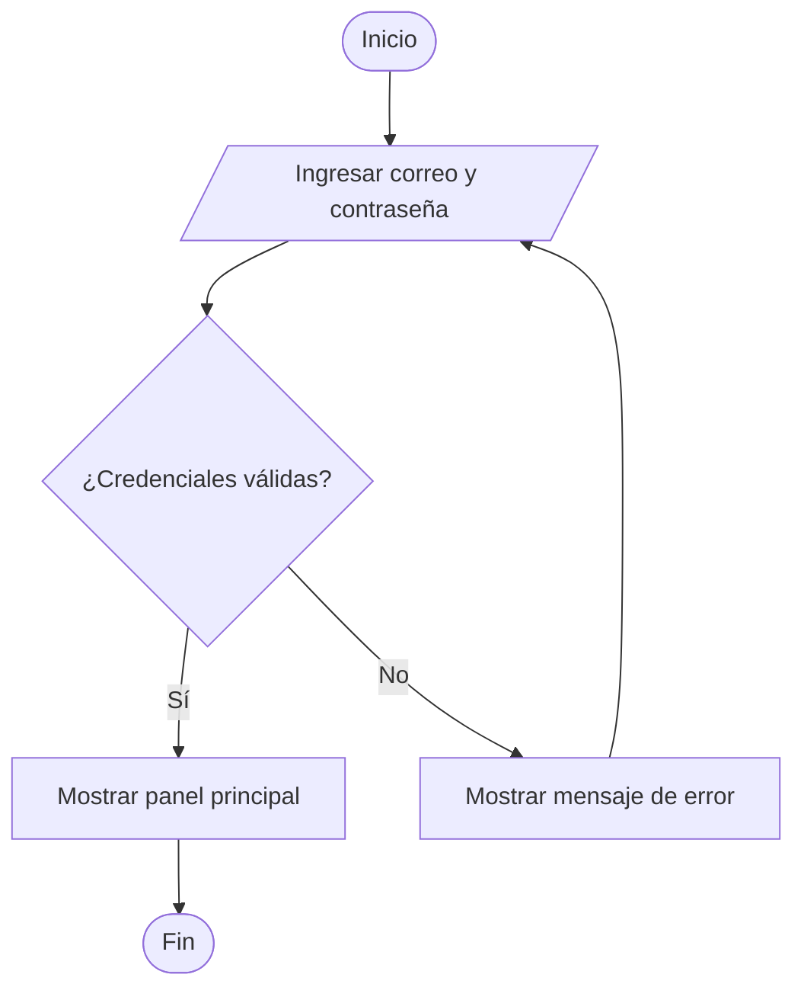

# Pensar antes de programar: flujos de trabajo y diagramas de flujo para principiantes

Antes de escribir una sola línea de código, los desarrolladores con experiencia hacen algo que los principiantes suelen saltarse: **dibujan el problema**. Un buen diagrama convierte una idea difusa en pasos concretos, y esos pasos son la base de cualquier programa.

En esta práctica aprenderás dos habilidades complementarias: visualizar flujos de trabajo con **Excalidraw** y representar la lógica con **diagramas de flujo estándar**.

## ¿Por qué dibujar un flujo?

Un flujo de trabajo describe **qué pasa, en qué orden y quién (o qué) lo hace**. Dibujarlo te permite:

- **Detectar huecos** en la lógica antes de que se conviertan en errores.
- **Comunicarte** con tu equipo (o con una IA) usando un lenguaje visual compartido.
- **Dividir** un problema grande en partes pequeñas y manejables.
- **Documentar** decisiones de forma rápida y entendible.

> Regla práctica: si no puedes dibujar el proceso, probablemente todavía no lo entiendes del todo.

## Excalidraw: pensar en voz alta con dibujos

[Excalidraw](https://excalidraw.com) es una pizarra virtual gratuita, abierta y sin registro, con estética de "boceto a mano". Ese estilo informal es una ventaja pedagógica: invita a **explorar sin miedo a que quede perfecto**.

**Lo básico que necesitas:**

| Herramienta | Para qué sirve |
|---|---|
| Rectángulo / rombo / elipse | Representar pasos, decisiones e inicio/fin |
| Flecha | Indicar la dirección del flujo |
| Texto | Nombrar cada paso con verbos claros |
| Colores y agrupación | Distinguir actores, fases o responsabilidades |

**Consejos para empezar:**

1. Escribe primero el objetivo en una frase, arriba del lienzo.
2. Usa **verbos en infinitivo** en cada paso ("Validar correo", "Guardar usuario").
3. Avanza de izquierda a derecha o de arriba hacia abajo, sin cruzar flechas.
4. Itera: mueve, borra y reorganiza. El primer borrador nunca es el definitivo.

## Diagramas de flujo estándar: un lenguaje común

Los diagramas de flujo usan símbolos convencionales para que cualquier persona los interprete igual. Conocerlos te da precisión.

| Símbolo | Forma | Significado |
|---|---|---|
| Inicio / Fin | Óvalo | Donde comienza o termina el proceso |
| Proceso | Rectángulo | Una acción u operación |
| Decisión | Rombo | Pregunta con respuesta Sí / No |
| Entrada / Salida | Paralelogramo | Datos que entran o salen |
| Flecha | Línea con punta | Orden de ejecución |

### Ejemplo: iniciar sesión en una aplicación

Observa cómo cada **rombo** tiene exactamente dos salidas y cómo el flujo puede **volver atrás** (un bucle) cuando algo falla. Esa es la semilla de un `if` y un `while` en código.

## De la pizarra al código

| En el diagrama | En el código |
|---|---|
| Rectángulo (proceso) | Instrucción o función |
| Rombo (decisión) | `if / else` |
| Flecha que regresa | Bucle (`while`, `for`) |
| Entrada / salida | Variables, `input`, `print` / `console.log` |

Si tu diagrama es claro, **traducirlo a código es casi mecánico**.

## Actividad práctica

**Reto:** elige un proceso cotidiano (pedir un café, reservar una cita, recuperar una contraseña).

1. Escribe el objetivo en una frase.
2. Dibuja el flujo en Excalidraw con inicio, fin, al menos **una decisión** y **un camino alternativo**.
3. Revisa: ¿hay algún paso ambiguo? ¿Algún camino sin salida?
4. Intercambia tu diagrama con un compañero y pídele que lo "ejecute" siguiendo las flechas.

**Autoevaluación rápida:**

- [ ] Mi diagrama tiene un único inicio y al menos un fin.
- [ ] Cada decisión tiene todas sus salidas rotuladas.
- [ ] Cada paso empieza con un verbo.
- [ ] Alguien más pudo entenderlo sin que yo se lo explicara.
