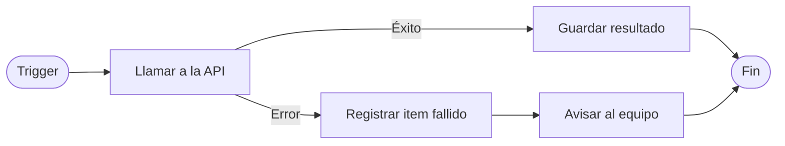
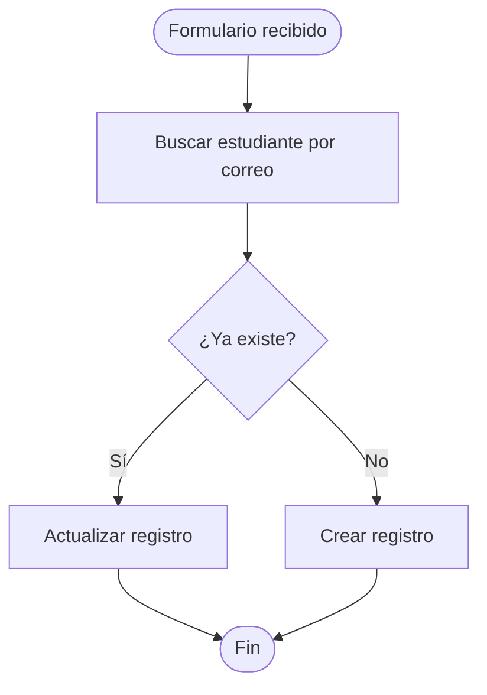

# n8n robusto: de un flujo que funciona a un flujo que no se rompe

Construir tu primer workflow en n8n es emocionante: llega un formulario, se guarda en una hoja de cálculo, sale un correo y todo funciona. Pero ese es el **camino feliz**, el escenario donde todo sale bien.

En el mundo real pasan cosas como estas:

- La API que consultas está caída justo cuando se ejecuta tu flujo.
- Un usuario envía el formulario **sin correo** o con un correo mal escrito.
- El flujo se ejecuta dos veces y **duplica** un registro.
- Llegan 500 registros en lugar de uno y el flujo se comporta distinto.
- Falla un paso y **nadie se entera** hasta que alguien se queja.

> Un workflow robusto no es el que nunca falla, sino el que **sabe qué hacer cuando algo falla**.

En este artículo vas a profundizar en los conceptos que separan una automatización de práctica de una automatización de producción.

**Requisito previo:** conocer los conceptos básicos de n8n: workflow, trigger, nodos, conexiones, JSON y expresiones.


## Repaso express

| Concepto | En una frase |
|---|---|
| Trigger | El evento que inicia el flujo |
| Nodo | Una unidad de trabajo con una responsabilidad concreta |
| Conexión | Lleva los datos de un nodo al siguiente |
| Item | Cada elemento (objeto JSON) que circula por el flujo |
| Expresión | Una fórmula como `{{ $json.email }}` que calcula un valor dinámico |

El concepto que más vas a necesitar desde ahora es el de **item**. Presta atención a la siguiente sección.

## Piensa en items: un nodo, muchos datos

En n8n, los datos viajan como una **lista de items**. Si un nodo recibe 10 items, normalmente **ejecuta su operación una vez por cada uno**. Por ejemplo, si una consulta a una base de datos devuelve 10 estudiantes, un nodo de correo enviará **10 correos**, uno por cada item. Esto es muy potente, pero también explica muchos errores de principiantes: "¿por qué se enviaron tantos correos?".

Algunos nodos clave para trabajar con items:

| Nodo | Para qué sirve |
|---|---|
| **Edit Fields (Set)** | Crear, renombrar o limpiar campos de cada item |
| **Filter** | Quedarte solo con los items que cumplen una condición |
| **Aggregate** | Juntar muchos items en uno solo (por ejemplo, para enviar un único resumen) |
| **Loop Over Items** | Procesar los items en lotes, útil para respetar límites de una API |
| **Code** | Escribir JavaScript cuando los nodos visuales no alcanzan |

**Regla práctica:** antes de conectar un nodo que *envía* algo (correo, mensaje, escritura), pregúntate cuántos items le van a llegar.

## Tomar decisiones: IF, Switch y Merge

Un flujo robusto necesita **caminos distintos** según los datos. Si dibujaste diagramas de flujo, esto te resultará familiar: son tus **rombos**.

| Nodo | Cuándo usarlo |
|---|---|
| **IF** | Una pregunta con dos salidas: verdadero o falso |
| **Switch** | Varias salidas según el valor de un campo (por ejemplo, según el curso elegido) |
| **Merge** | Volver a unir caminos o combinar datos de dos fuentes |

Ejemplo de condición en un nodo IF:

```
{{ $json.edad >= 18 }}
```

Y un Switch podría enviar a cada estudiante a un camino distinto según `{{ $json.curso }}`: uno para "Data Analytics", otro para "Full Stack", otro para "Ciberseguridad".


## Valida la entrada: desconfía de los datos

La regla de oro de la robustez: **nunca asumas que los datos llegan bien**. Justo después del trigger, agrega un paso de validación. Por ejemplo, un nodo IF que compruebe que los campos esenciales existen y no están vacíos:

```
{{ $json.email && $json.email.includes('@') && $json.nombre }}
```

- Si **es verdadero**, el flujo continúa.
- Si **es falso**, el flujo toma un camino alternativo: guardar el registro en una lista de "pendientes de revisión" o avisar a una persona.

Validar al inicio es más barato que descubrir, tres pasos después, que escribiste datos incorrectos en tu base de datos.


## Manejo de errores: tres capas de protección

Los errores se manejan en **tres niveles**, de lo más local a lo más global. Piensa en ellos como las capas de una cebolla.

### Capa 1: Retry On Fail (reintentar)

En la pestaña **Settings** de un nodo puedes activar **Retry On Fail**. Configuras cuántos intentos máximos hacer (**Max Tries**) y cuánto esperar entre ellos (**Wait Between Tries**).

- **Cuándo usarlo:** fallos **temporales**, como un timeout o una API que respondió con error momentáneo, en operaciones que son seguras de repetir.
- **Cuándo NO:** errores que nunca se van a arreglar solos, como una contraseña incorrecta o un dato inválido. Reintentar eso solo pierde tiempo.

> Cuidado: antes de reintentar una operación que *crea* algo (un pago, un registro, un correo), asegúrate de que repetirla no genere duplicados.

### Capa 2: On Error (qué hace el nodo cuando falla)

También en **Settings**, la opción **On Error** define el comportamiento del nodo cuando falla:

| Opción | Qué ocurre |
|---|---|
| **Stop Workflow** | Detiene todo el flujo (comportamiento por defecto) |
| **Continue** | Sigue al siguiente nodo a pesar del error |
| **Continue (using error output)** | Crea una **salida especial de error** hacia la que puedes conectar un camino de recuperación |

La tercera opción es la más útil para construir flujos robustos, porque te permite separar lo que salió bien de lo que falló:



Así, si 3 de 500 registros fallan, **procesas 497** y solo revisas 3 en lugar de repetir todo.

### Capa 3: Error Workflow y Error Trigger (la red de seguridad global)

¿Y si falla algo que no previste? Para eso existe el **Error Trigger**.

La idea es crear un **workflow aparte**, dedicado a manejar fallos:

1. Crea un nuevo workflow, por ejemplo llamado `[Sistema] Alerta de errores`.
2. Su primer nodo es **Error Trigger**.
3. Conéctale un nodo que te avise (correo, Slack, Telegram...).
4. En el workflow principal, abre **Settings** y selecciona ese flujo en el campo **Error workflow**.

Cuando el flujo principal falle de forma no controlada, el Error Trigger se activa y recibe información útil, como el nombre del workflow, el ID de la ejecución y el mensaje de error:

```
{{ $json.workflow.name }}
{{ $json.execution.id }}
{{ $json.execution.error.message }}
```

Tres detalles importantes para no llevarte sorpresas:

- El Error Trigger **no se activa al ejecutar manualmente** desde el editor. Se prueba con una ejecución automática real.
- Puedes provocar un error con intención usando el nodo **Stop And Error**, ideal para probar tu alerta o para marcar como fallo una situación de negocio ("el pago fue rechazado").
- Un error workflow configurado **no garantiza que funcione**. Pruébalo de verdad antes de confiar en él.

## Evita los duplicados: piensa en idempotencia

Un flujo es **idempotente** cuando ejecutarlo dos veces con los mismos datos produce el mismo resultado que ejecutarlo una sola vez.

¿Por qué importa? Porque los reintentos, las re-ejecuciones manuales y los triggers repetidos son normales. Si tu flujo no es idempotente, cada repetición ensucia tus datos.

**Estrategias comunes:**

1. **Buscar antes de crear.** Antes de insertar un estudiante, consulta si ya existe uno con ese correo. Si existe, actualiza en lugar de crear.
2. **Usar una clave única.** Elige un campo que identifique al registro (correo, ID de pedido) y úsalo como referencia.
3. **Quitar duplicados dentro del lote.** n8n incluye un nodo para eliminar items repetidos (**Remove Duplicates**).
4. **Registrar lo ya procesado.** Marca cada registro con un estado ("procesado") para no repetirlo.




## Seguridad y configuración

Un flujo robusto también es un flujo **seguro**.

- **Credenciales:** guarda las claves de acceso en el sistema de **Credentials** de n8n. Nunca escribas contraseñas o tokens directamente dentro de un nodo o de un nodo Code.
- **Datos sensibles:** piensa qué datos personales manejas (correos, edades, documentos) y evita guardarlos o enviarlos a lugares donde no corresponde.
- **Autoalojamiento:** si instalas n8n tú mismo, la seguridad de la infraestructura (accesos, actualizaciones, copias de seguridad) también pasa a ser tu responsabilidad.


## Conclusión

Automatizar es sencillo; automatizar **bien** es una habilidad profesional. Un workflow robusto valida lo que recibe, controla cuántos datos procesa, se recupera de los errores, no duplica información, se divide en piezas reutilizables y avisa cuando algo sale mal. Si adoptas el hábito de preguntarte "¿y si esto falla?" en cada paso, pasarás de construir demostraciones a construir **sistemas en los que otros pueden confiar**.