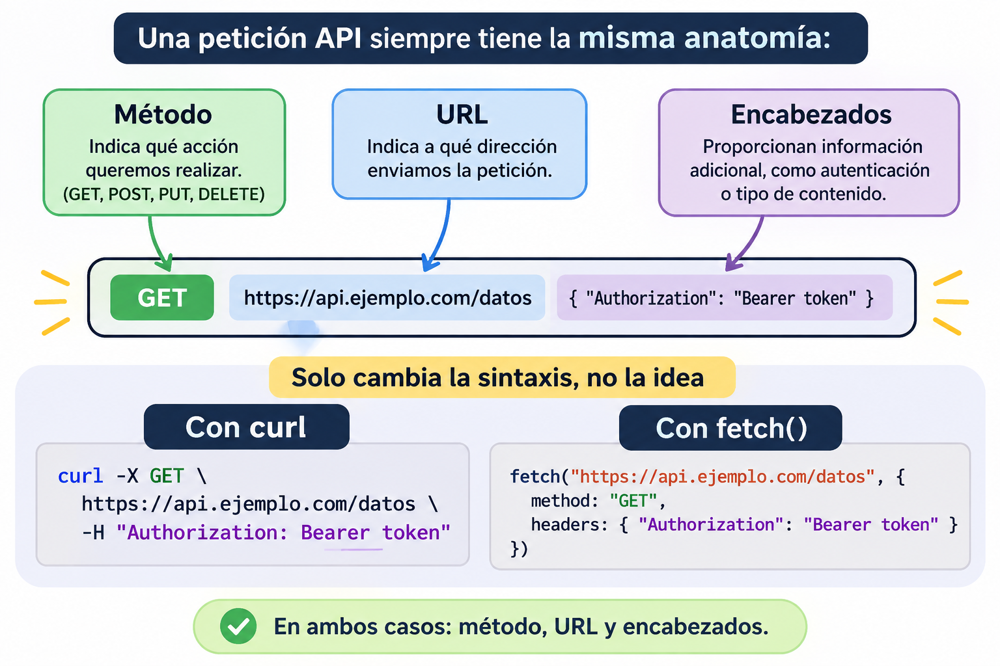

# Capacitar al agente: conectar OpenClaw con el mundo

Hasta ahora, el agente vive en una VPS, cuenta con memoria y herramientas, pero aún le falta lo más importante: comunicarse con el exterior.

Para cualquier ingeniero de software y de IA, el mundo se reduce a dos preguntas:

- ¿Cómo se intercambian datos entre sistemas? (APIs y protocolos)
- ¿Cómo se protege la información sensible? (credenciales y seguridad)

A continuación, se revisan los fundamentos que se utilizarán durante el resto de la carrera, sin importar si se trabaja con Python, Node.js, OpenClaw o cualquier tecnología que aparezca en el futuro.

## El fundamento de Internet: el modelo cliente-servidor (APIs)

Imaginemos un restaurante:

- El cliente es quien necesita un dato y realiza la solicitud (`Request`).
- El servidor (GitHub, 4Geeks, una base de datos) es quien almacena la información y los recursos.
- La API funciona como un mozo: lleva la solicitud y devuelve la respuesta (`Response`).

Concepto clave: una API (Application Programming Interface) es un contrato de comunicación ordenado. Indica, de forma clara, qué tipo de solicitud se puede realizar y qué respuesta se recibirá.

### ¿Cómo viaja una solicitud en la práctica?

Vamos a mirar un pedido real, pieza por pieza. Abre la terminal de tu VPS y ejecuta:

```bash
curl https://api.github.com/zen
```

`curl` es un comando que hace un pedido a una dirección de internet. Vas a recibir una frase corta (cambia cada tanto). Acabas de usar una API.

Ahora la radiografía:

```text
curl  https://api.github.com/zen
│     │
│     └── LA DIRECCIÓN (URL): a dónde va el pedido.
│         Se compone de:
│           • https://api.github.com  → el sistema (la cocina)
│           • /zen                    → el "plato" que pedís (endpoint)
│
└── LA HERRAMIENTA: quien hace el pedido (en tu caso, tu agente
    lo hará por ti)
```

Cada "plato" disponible se llama _endpoint_. Un sistema grande tiene decenas de endpoints, como un menú con muchas opciones.




### La respuesta universal: estados y JSON

Cuando el servidor responde, siempre entrega dos elementos fundamentales:

- El código de estado HTTP: un número que indica el resultado de la solicitud.
- El formato JSON: un texto estructurado en pares clave-valor.

#### Códigos de estado HTTP

- `200`: la solicitud fue exitosa.
- `401`: no se reconoce la identidad del cliente.
- `404`: el recurso solicitado no existe.
- `500`: error interno del servidor.

### JSON: el idioma de las respuestas

La mayoría de las APIs responden en JSON, un formato de texto ordenado en pares clave: valor. Probá este pedido:

```bash
curl https://api.github.com/users/octocat
```

Vas a ver algo así (recortado):

```json
{
  "login": "octocat",
  "id": 583231,
  "type": "User",
  "public_repos": 8
}
```

Se lee fácil: `login` es la clave, `octocat` es el valor. Es como una ficha de datos.

## El fundamento de la seguridad: variables de entorno y secretos

En la práctica anterior consultaste APIs públicas: cualquiera puede pedir esos datos. Pero la mayoría de los sistemas interesantes (tu cuenta, tus datos, un modelo de IA) piden que te identifiques. Ahora veamos que es una API key.

Una API key o token es como la llave de tu casa:

- Quien la tiene, entra como si fuera vos.
- Si la perdés o la regalás, no importa cuánto te cuides: alguien más puede usarla.
- No la dejás pegada con cinta en la puerta.

A estas llaves las llamamos secretos. Y la regla de oro es:

> Un secreto nunca se escribe en el chat, nunca se sube a GitHub y nunca se deja a la vista.

## Antes y después: dónde NO y dónde SÍ

| Antes (mal) | Después (bien) |
| --- | --- |
| Pegar la llave en el chat con el agente | Guardarla en un archivo `.env` fuera de tu código |
| Escribirla dentro de un archivo que subís a GitHub | Referenciarla por nombre (`${MI_LLAVE}`) |
| Compartirla por captura de pantalla | Cuidar permisos y no mostrarla en pantallas |
| Una sola llave "para todo" | Una llave por propósito, fácil de revocar |

## Variables de entorno: etiquetas con un valor escondido

Una variable de entorno es un par `NOMBRE=valor` que el sistema guarda fuera de tu código. Los programas la leen por su nombre, y el valor nunca aparece escrito en el archivo que compartís.

```text
   Código / configuración            Archivo .env (privado)
   ───────────────────────           ─────────────────────────
   usa:  ${MI_LLAVE}      ─────►     MI_LLAVE=abc123secreto
   (solo el NOMBRE)                  (el VALOR, escondido)
```

Es como decir "usá la llave del cajón de la entrada" sin escribir qué llave es.

## ¿Dónde busca OpenClaw las variables de entorno?

El Gateway de OpenClaw puede obtener variables de entorno desde diferentes lugares.

Si una variable está definida en varios sitios, **prevalece la primera que encuentra según este orden de prioridad**. Las siguientes no reemplazan su valor.

1. **Entorno del proceso:** variables que el sistema operativo ya entregó al Gateway. Tiene la mayor prioridad.
2. **`.env` local:** archivo ubicado en el directorio desde donde se ejecuta el proceso.
3. **`.env` global:** archivo `~/.openclaw/.env`. Es el recomendado para centralizar las variables de entorno de OpenClaw en tu VPS.
4. **Bloque `env` de `~/.openclaw/openclaw.json`:** configuración alternativa, con menor prioridad.

**Importante:** Si todavía no existe `~/.openclaw/.env`, es normal. Puedes crearlo en el siguiente paso.

## Poniéndolo en práctica: conectar OpenClaw con 4Geeks

A continuación, se combinan los dos fundamentos: protocolos HTTP y autenticación por token para consultar la plataforma real de 4Geeks.

### Guardar la llave de forma segura en la VPS

```bash
nano ~/.openclaw/.env
```

Agregar el token:

```env
FOURGEEKS_TOKEN=pega_tu_token_aqui
```

Restringir el acceso al archivo para que solo el usuario actual pueda leerlo:

```bash
chmod 600 ~/.openclaw/.env
```

### Realizar una solicitud autenticada

La credencial no se envía como texto libre en el mensaje; se incluye en los encabezados (`Headers`) del protocolo HTTP.

```bash
curl -H "Authorization: Token $FOURGEEKS_TOKEN" https://URL_BASE_DE_4GEEKS/v1/auth/user/me
```

- `-H`: agrega un encabezado de autorización.
- Es equivalente a presentar un documento de identidad al momento de realizar la solicitud.


### Usar la variable desde la configuración (el puente final)

Ya guardaste tu secreto (`FOURGEEKS_TOKEN`) de forma segura en el archivo `.env`. ¿Cómo lo usa OpenClaw (o cualquier herramienta de IA) sin que nadie lo vea?

En los archivos de configuración de tus agentes o herramientas, nunca escribís la contraseña a mano. Usás una referencia por nombre con la sintaxis `${NOMBRE}`:

```json
"skills": {
    "entries": {
      "authenticate-4geeks": {
        "enabled": true,
        "env": {
          "FOURGEEKS_TOKEN": "${FOURGEEKS_TOKEN}",     
        }
      }
    }
}
```

#### ¿Qué pasa en el archivo de configuración?

- Se ve: el nombre de la variable (`FOURGEEKS_TOKEN`) y bloque `skills`. Todo esto es totalmente inofensivo.
- No se ve: el valor real de tu token (vive protegido y escondido dentro del archivo `.env`).

Si alguien te roba o lee tu archivo de configuración, no se lleva ninguna llave. Ese es el estándar de oro en ciberseguridad.

> 💡 Nivel avanzado: a medida que crezcas como ingeniero, verás que herramientas como OpenClaw usan sistemas más complejos (como gestores de secretos corporativos). Pero dominar el patrón `${NOMBRE}` con tu archivo `.env` local es el primer y más importante escalón para cualquier entorno de desarrollo.

### Instrucción para el agente

> "Realiza una petición a breathecode.herokuapp.com/v1/admissions/user/me/ enviando el encabezado Authorization: Token $FOURGEEKS_TOKEN enviando el encabezado Authorization: Token $FOURGEEKS_TOKEN. Extrae únicamente mi nombre del JSON recibido y respóndeme solo con esa información. Nunca muestres ni imprimas el token."

## Si una llave se expone: qué hacer

Si pegaste una llave en un chat, la subiste a GitHub o la mostraste en pantalla, asumí que está comprometida:

1. Revocala o regenerala en el sitio del proveedor.
2. Guardá la nueva en el `.env`.
3. No alcanza con borrar el mensaje: borrarlo no la vuelve segura.


## Para cerrar

Si se comprende esto, se entiende gran parte del funcionamiento de la arquitectura de software moderna:

- Las aplicaciones se comunican mediante HTTP enviando requests y recibiendo responses.
- Los datos se transmiten en un formato ordenado: JSON.
- Los estados se interpretan a través de códigos numéricos (`200`, `401`, `404`).
- Las credenciales se mantienen aisladas en variables de entorno (`.env`).
