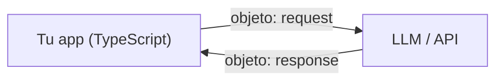
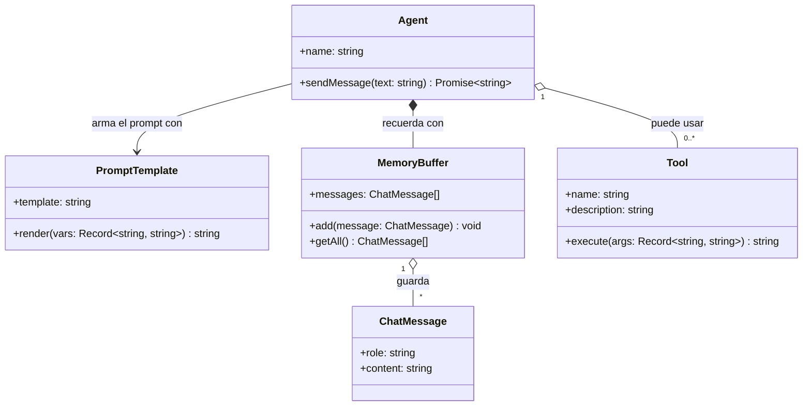

# Modelando la vida con objetos

**Cómo hablan las aplicaciones de IA: objetos, contratos de datos y piezas reutilizables**

> **Qué vas a lograr en este módulo**
> - Leer y escribir objetos en TypeScript como los que viajan hacia y desde un LLM.
> - Definir contratos de datos (`interface` / `type`) para que una respuesta inesperada del modelo no rompa la aplicación.
> - Manejar colecciones: historiales de chat, registros de tokens y catálogos de herramientas.
> - Planificar un sistema de IA con un diagrama de clases y construir sus piezas con `class`.


## El mapa general: por qué los objetos son el idioma de la IA

Antes de escribir una línea de código, mantén esta imagen en mente. Cada vez que la aplicación conversa con un modelo de lenguaje, ocurre lo mismo:



Lo que viaja en ambas direcciones son **objetos**: estructuras con nombre y valor (JSON). El mensaje que se envía, la configuración del modelo, la respuesta, las herramientas que el agente puede usar y el historial de la conversación: todo son objetos organizados en listas y diccionarios.

> **Idea clave:** trabajar con IA consiste, en gran parte, en **construir bien los objetos que se envían al modelo y validar bien los objetos que devuelve**.


## De la idea a los datos: el objeto literal

### Un mensaje de chat es un objeto

Cuando se escribe a un asistente, lo que recibe la API no es "texto suelto". Cada mensaje es un objeto con dos propiedades:

```typescript
const message = {
  role: "user",
  content: "Explicame qué es un token en una frase.",
};
```

- `role` indica **quién habla** (`"system"`, `"user"` o `"assistant"`).
- `content` es **lo que dice**.

Una **propiedad** es un par *nombre → valor*. Un objeto es un conjunto de propiedades que describen una misma cosa. Eso es todo.

### Leer y modificar propiedades

```typescript
console.log(message.role);        // "user"
console.log(message["content"]);  // "Explicame qué es un token en una frase."

message.content = "Explicame qué es un embedding.";   // modificar
```

Hay dos notaciones:

| Notación | Ejemplo | Cuándo usarla |
|---|---|---|
| **Punto** | `message.role` | Casi siempre: es más legible |
| **Corchetes** | `message["role"]` | Cuando el nombre de la propiedad está en una variable |

### Objetos dentro de objetos

Una petición real a un LLM combina varias cosas. Observe cómo un objeto contiene valores simples, una lista y hasta otros objetos:

```typescript
const request = {
  model: "un-modelo-de-ejemplo",
  temperature: 0.2,
  max_tokens: 300,
  messages: [
    { role: "system", content: "Sos un asistente que responde en español, breve y claro." },
    { role: "user", content: "¿Para qué sirve la temperatura en un modelo?" },
  ],
};

console.log(request.messages[1].content);
// "¿Para qué sirve la temperatura en un modelo?"
```

Para llegar a un dato "profundo", se encadenan accesos: `request.messages[1].content`. Se lee de izquierda a derecha como un camino: *request → messages → segundo elemento → content*.

### Objetos que también hacen cosas

Una propiedad puede guardar una **función**. Así se define, por ejemplo, una herramienta (*tool*) que un agente puede ejecutar:

```typescript
const getTime = {
  name: "getTime",
  description: "Devuelve la hora actual en formato HH:MM",
  execute: () => new Date().toTimeString().slice(0, 5),
};

console.log(getTime.description); // dato
console.log(getTime.execute());   // comportamiento
```

Observe que el mismo objeto tiene **datos** (`name`, `description`) y **comportamiento** (`execute`). Esa combinación es la razón de ser de la programación orientada a objetos, y ya se está usando sin escribir ninguna `class`.


## Contratos de datos para IA: `interface` y `type`

### El problema: el LLM es impredecible

Imagine que se solicita a un modelo que clasifique el sentimiento de una reseña y que responda en JSON. Lo que *se espera* recibir:

```json
{ "sentiment": "positive", "confidence": 0.93, "keywords": ["rápido", "excelente"] }
```

Pero un modelo puede, en ocasiones, devolver `"sentimiento"` en lugar de `"sentiment"`, un `confidence` como texto (`"alta"`) o, directamente, omitir una propiedad. Si el código asume que todo llega perfecto, **se rompe en producción**.

Se necesita un **contrato**: una descripción exacta de la forma que *debe* tener el dato. En TypeScript, ese contrato se escribe con `interface` o `type`.

### Escribir el contrato

```typescript
interface SentimentResult {
  sentiment: "positive" | "neutral" | "negative";
  confidence: number;
  keywords: string[];
  summary?: string; // el "?" marca una propiedad opcional
}
```

Algunas partes a destacar:

- `"positive" | "neutral" | "negative"` es un **tipo unión de literales**: el valor solo puede ser uno de esos tres textos. Es ideal para etiquetas de clasificación.
- `string[]` significa "lista de textos".
- `summary?` es opcional: puede estar o no.

Ahora el editor protege el código:

```typescript
const result: SentimentResult = {
  sentiment: "muy positivo",   // ❌ Error: no es una de las tres etiquetas
  confidence: "alta",          // ❌ Error: se esperaba number
  keywords: ["rápido"],
};
```

### Tipar mensajes, contextos y configuración

Lo mismo sirve para los objetos de la sección anterior:

```typescript
type Role = "system" | "user" | "assistant";

interface ChatMessage {
  role: Role;
  content: string;
}

interface ModelConfig {
  model: string;
  temperature: number;
  maxTokens: number;
}

interface ChatRequest {
  config: ModelConfig;
  messages: ChatMessage[];
}
```

Con esto, escribir `role: "usuario"` es un error **antes de ejecutar** el programa.

> **`interface` o `type`:** para describir la forma de un objeto, ambos funcionan y, para empezar, son prácticamente intercambiables. Se recomienda usar `interface` para objetos y `type` para uniones como `Role`. Esa regla alcanza por ahora.

## Colecciones de datos en IA: arrays y diccionarios

### El historial de conversación: `ChatMessage[]`

Un modelo no "recuerda" nada entre llamadas. Para que tenga contexto, **se reenvía todo el historial** en cada solicitud. Ese historial es, simplemente, un array de objetos:

```typescript
const history: ChatMessage[] = [
  { role: "system", content: "Sos un tutor de programación, claro y paciente." },
  { role: "user", content: "¿Qué es un array?" },
  { role: "assistant", content: "Es una lista ordenada de valores." },
  { role: "user", content: "¿Y un array de objetos?" },
];

// agregar un mensaje nuevo al final
history.push({ role: "assistant", content: "Es una lista donde cada elemento es un objeto." });
```

### Operaciones que se usan todo el tiempo

**`filter`: quedarse con los elementos que cumplen una condición.** Por ejemplo, ver solo lo que dijo el usuario:

```typescript
const userMessages = history.filter((m) => m.role === "user");
```

**`map`: transformar cada elemento.** Por ejemplo, armar un texto plano del chat para guardarlo en un log:

```typescript
const transcript = history.map((m) => `${m.role}: ${m.content}`).join("\n");
```

**`find`: buscar el primero que cumpla una condición.**

```typescript
const firstUserQuestion = history.find((m) => m.role === "user");
```

### Diccionarios: encontrar rápido por nombre

Cuando un agente tiene varias herramientas y el modelo indica que se quiere usar `getTime`, es necesario **encontrarla por su nombre al instante**. Recorrer una lista cada vez es incómodo; para eso sirve un diccionario, que en TypeScript se tipa como `Record<clave, valor>`:

```typescript
interface Tool {
  name: string;
  description: string;
  execute: (args: Record<string, string>) => string;
}

const tools: Record<string, Tool> = {
  getTime: {
    name: "getTime",
    description: "Devuelve la hora actual",
    execute: () => new Date().toTimeString().slice(0, 5),
  },
  shout: {
    name: "shout",
    description: "Devuelve un texto en mayúsculas",
    execute: (args) => (args.text ?? "").toUpperCase(),
  },
};

const requested = "shout";               // lo que pidió el modelo
const tool = tools[requested];
if (tool) {
  console.log(tool.execute({ text: "hola" })); // "HOLA"
}
```

El mismo patrón sirve para un catálogo de modelos disponibles (`Record<string, ModelInfo>`) o para plantillas de prompt por nombre.

> **Regla práctica:** ¿se necesita recorrer todo en orden (como un chat)? → **array**. ¿Se necesita encontrar uno por su nombre o identificador (como una tool)? → **diccionario**.

## Diseñando sistemas de IA: receta de modelado y diagramas de clases


Un chatbot con una sola llamada se programa en diez líneas. Un **agente** (que recuerda, utiliza herramientas y arma prompts) tiene muchas piezas que se relacionan. Si se codifica sin un mapa, se puede terminar enredado. Los equipos de IA dibujan primero.

### La receta en 5 pasos

Tomemos este enunciado:

> *"Quiero un asistente que reciba mensajes del usuario, recuerde la conversación, arme el prompt a partir de una plantilla, llame a un modelo y pueda usar herramientas."*

1. **Subrayar los sustantivos:** asistente (`Agent`), mensajes (`ChatMessage`), conversación recordada (`Memory`), plantilla (`PromptTemplate`), herramientas (`Tool`). Son candidatos a **piezas del sistema**.
2. **Subrayar los verbos:** *recibir, recordar, armar, llamar, usar*. Son candidatos a **acciones** (métodos).
3. **Preguntar qué datos necesita cada pieza:** una plantilla necesita su texto; una herramienta, nombre y descripción; la memoria, una lista de mensajes.
4. **Descartar lo que no hace falta ahora:** modelar es simplificar. No se agregan cosas "por si acaso".
5. **Conectar las piezas:** ¿quién usa a quién? ¿quién contiene a quién?

### El diagrama de clases

Un diagrama de clases es un mapa visual de esas piezas. Cada caja tiene el nombre arriba, los **datos** en el medio y las **acciones** abajo. Las líneas muestran las relaciones. Se escribe en **Mermaid**, un lenguaje de texto que GitHub, Notion y VS Code (con extensión) convierten en un dibujo:



### Cómo leer las relaciones

| Símbolo | Nombre | Se lee como | En el ejemplo |
|---|---|---|---|
| `-->` | Asociación | "usa" | El `Agent` usa una `PromptTemplate` |
| `o--` | Agregación | "tiene (pero puede existir solo)" | El `Agent` tiene `Tool`s; las tools existen sin él |
| `*--` | Composición | "está hecho de (muere con el todo)" | La `MemoryBuffer` pertenece al `Agent` |
| `<|--` | Herencia | "es un tipo de" | (no la necesitamos acá) |

Y la **multiplicidad** indica cuántos: `1` (uno), `0..*` (cero o más), `*` (muchos).

Los símbolos de visibilidad: `+` público (se puede usar desde afuera) y `-` privado (solo dentro de la pieza).


### Errores frecuentes al modelar

- **Una pieza que hace todo:** si el `Agent` arma prompts, valida JSON, guarda logs y llama a tres APIs, son varias piezas.
- **Modelar de más:** atributos y clases que nadie usa.
- **Confundir el molde con el objeto:** `Agent` es el diseño; "el agente de soporte" es una instancia concreta.


## Encapsulando lógica: clases e instancias

### ¿Cuándo aparece la necesidad de una `class`?

Con objetos literales ya se puede guardar el historial. Pero observe lo que ocurre cuando se quiere una memoria que **no crezca sin límite** (los modelos tienen un tope de contexto) y que viva junto con sus propias reglas. Sería necesario repartir por todo el código el array, el límite y la lógica de recorte, con riesgo de olvidarse de aplicarla en algún momento.

Una **clase** resuelve esto: es un **molde** que reúne *datos* (estado) y *acciones* (métodos) en una sola pieza reutilizable. A partir del molde se crean las **instancias** con `new`.

### Nuestra primera clase: `MemoryBuffer`

```typescript
class MemoryBuffer {
  private messages: ChatMessage[] = [];

  constructor(private maxMessages: number) {}

  add(message: ChatMessage): void {
    this.messages.push(message);
    if (this.messages.length > this.maxMessages) {
      this.messages.shift(); // descarta el mensaje más viejo
    }
  }

  getAll(): ChatMessage[] {
    return [...this.messages]; // devolvemos una copia
  }
}
```

Ahora aparecen tres conceptos nuevos, y cada uno tiene un propósito:

| Concepto | Qué hace | Por qué lo necesitamos acá |
|---|---|---|
| `constructor` | Se ejecuta al crear la instancia con `new` | Para recibir el límite (`maxMessages`) |
| `private` | Oculta el dato: solo la clase puede tocarlo | Para que nadie agregue mensajes sin respetar el recorte |
| `this` | "El objeto que está ejecutando este método" | Para acceder al estado de **esta** instancia |

Usarla:

```typescript
const memory = new MemoryBuffer(3);
memory.add({ role: "user", content: "Hola" });
memory.add({ role: "assistant", content: "¡Hola! ¿En qué te ayudo?" });
memory.add({ role: "user", content: "Contame qué es un token" });
memory.add({ role: "assistant", content: "Es un fragmento de texto..." });

console.log(memory.getAll().length); // 3  (el primer mensaje se descartó solo)
```

Cada instancia tiene **su propio estado**: si se crea otra `MemoryBuffer`, tendrá su propia lista independiente.

## Los conceptos, bajados a tierra

| Concepto | Pregunta que responde | En un proyecto de IA |
|---|---|---|
| **Objeto** (`{ clave: valor }`) | ¿Qué es esta cosa concreta? | Un mensaje `{ role, content }` o un payload de petición |
| **Propiedad** | ¿Cómo la describo? | `role`, `temperature`, `confidence` |
| **`interface` / `type`** | ¿Qué forma *debe* tener? | El esquema esperado de una respuesta del LLM |
| **Validación** | ¿Realmente cumple la forma? | Verificar el JSON recibido antes de usarlo |
| **Array de objetos** | ¿Cómo manejo muchos, en orden? | `ChatMessage[]`, `TokenUsage[]` |
| **Diccionario** (`Record`) | ¿Cómo encuentro uno por nombre? | Catálogo de `Tool`s o de modelos |
| **Diagrama de clases** | ¿Cómo se relacionan las piezas? | Mapa de `Agent`, `Memory`, `Tool`, `PromptTemplate` |
| **Clase** | ¿Cómo empaqueto estado + comportamiento? | `MemoryBuffer`, `Agent` |
| **Instancia** (`new`) | ¿Cuál es *esta* pieza concreta? | "El agente de soporte" con su propia memoria |
