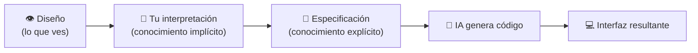
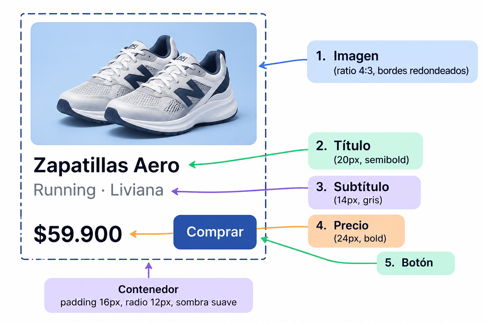
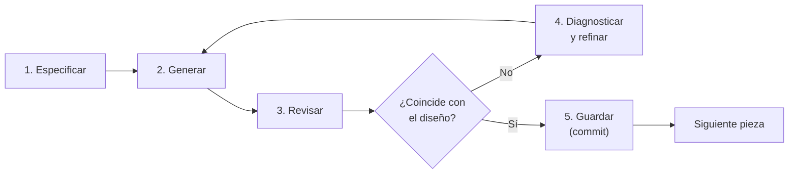
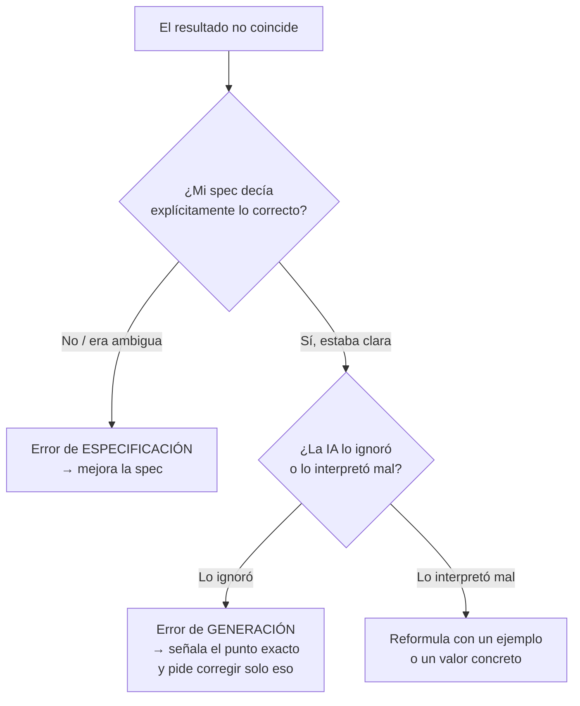

# Proporcionando especificaciones visuales a la IA

Cuando miras un diseño, nuestro cerebro reconoce jerarquías, alineaciones, espacios, "esto es un botón principal". Todo eso es **conocimiento implícito**.

Una IA que recibe tu texto (o incluso tu imagen) necesita que ese conocimiento esté **explícito**: qué elementos hay, cómo se organizan, qué medidas tienen, cómo cambian.



**La especificación es el puente.** Si el puente tiene huecos, la IA los rellena con suposiciones.


## Visual to Spec — del diseño a la especificación

### 1. Las siete capas de una especificación visual

Una buena spec responde siete preguntas. Piensa en ellas como capas que vas apilando:

| # | Capa | Pregunta que responde | Ejemplo |
|---|------|----------------------|---------|
| 1 | **Estructura** | ¿Qué elementos existen y cómo se anidan? | Tarjeta > imagen + título + precio + botón |
| 2 | **Layout** | ¿Cómo se acomodan en el espacio? | Columna vertical, elementos centrados |
| 3 | **Tokens de diseño** | ¿Qué colores, tipografías y espaciados usa? | Fondo `#FFFFFF`, texto `#1F2937`, padding 16px |
| 4 | **Estados** | ¿Cómo se ve normal, hover, focus, deshabilitado? | Botón cambia a azul oscuro en hover |
| 5 | **Responsive** | ¿Cómo cambia según el tamaño de pantalla? | 1 columna en móvil, 3 en escritorio |
| 6 | **Contenido** | ¿Qué texto e imágenes reales lleva? | "Zapatillas Aero – $59.900" |
| 7 | **Accesibilidad** | ¿Qué necesita para ser usable por todas las personas? | Contraste suficiente, `alt` en imágenes, foco visible |


Para no perderte, sigue siempre este recorrido:

1. **D**escomponer: divide el diseño en bloques grandes y luego en piezas pequeñas.
2. **E**tiquetar: ponle nombre a cada pieza (`ProductCard`, `PriceTag`, `AddToCartButton`).
3. **M**edir: asigna valores concretos (espacios, tamaños, colores), no adjetivos.
4. **E**stados: define qué pasa al interactuar.
5. **D**eclarar: escribe todo en un formato ordenado que la IA pueda leer.

### Ejemplo visual: descomponiendo una tarjeta

Observa este diseño:



### Antes y después: el mismo pedido, dos prompts

**❌ Prompt vago**

```text
Hazme una tarjeta de producto moderna y limpia con React y Tailwind.
```

*Qué pasa:* la IA inventa tamaños, colores, orden y estados. Tendrás que corregir casi todo.

**✅ Prompt con especificación visual**

```text
Crea un componente React + Tailwind llamado ProductCard.

ESTRUCTURA
- Contenedor > imagen, título, subtítulo, fila inferior (precio + botón).

LAYOUT
- Columna vertical. La fila inferior usa flex con justify-between e items-center.

ESTILO
- Contenedor: fondo blanco, padding 16px, bordes redondeados 12px, sombra suave.
- Imagen: ancho completo, ratio 4:3, bordes redondeados 8px, object-cover.
- Título: 20px, font-semibold, color gray-900.
- Subtítulo: 14px, color gray-500.
- Precio: 24px, font-bold.
- Botón: fondo indigo-600, texto blanco, padding 8px 16px, radio 8px.

ESTADOS
- Botón hover: indigo-700. Botón focus: anillo visible de 2px indigo-300.
- Tarjeta hover: sombra un poco más marcada.

RESPONSIVE
- Ancho máximo 320px y centrada en pantallas pequeñas.

ACCESIBILIDAD
- La imagen lleva alt descriptivo. El botón es un <button> real.

CONTENIDO DE EJEMPLO
- "Zapatillas Aero", "Running · Liviana", "$59.900", "Comprar".
```

*Qué pasa:* la IA ya no adivina. Los errores que queden serán pocos y fáciles de ubicar.


### 2. Plantilla reutilizable

Guárdala y úsala como punto de partida:

```text
COMPONENTE: [nombre]
OBJETIVO: [qué debe lograr la persona usuaria]

ESTRUCTURA: [jerarquía de elementos]
LAYOUT: [flex/grid, dirección, alineación]
ESTILO: [colores, tipografía, espaciado, bordes, sombras]
ESTADOS: [normal, hover, focus, deshabilitado, error, carga]
RESPONSIVE: [comportamiento por tamaño de pantalla]
CONTENIDO: [textos e imágenes reales o de ejemplo]
ACCESIBILIDAD: [contraste, alt, teclado, etiquetas]
NO HACER: [lo que la IA no debe asumir ni agregar]
```

> 💡 **Truco:** la sección **NO HACER** es muy poderosa. Ejemplo: "No agregues librerías externas", "No cambies la paleta", "No añadas animaciones".


## The Constructive Process — desarrollo frontend iterativo con IA

### 1. El error más común: esperar la perfección al primer intento

Muchas personas principiantes piensan: *"Si escribo el prompt perfecto, la IA me da la interfaz perfecta."* En la práctica profesional no funciona así, ni con IA ni sin ella. **Construir es un proceso, no un evento.**



Este ciclo se repite **en pasos pequeños**. Cada vuelta aprende algo y deja un resultado que puedes conservar.

### 2. Cuando algo sale mal: ¿es la spec o es la IA?

Este es el diagnóstico más valioso del módulo. Antes de reescribir todo, pregúntate:



### 3. Cómo dar buen feedback a la IA

**❌ Feedback vago**

```text
Se ve raro, arréglalo.
```

**✅ Feedback accionable**

```text
El botón está pegado al borde derecho. Según la spec, el contenedor tiene
padding de 16px. Corrige solo el padding del contenedor y no toques
nada más del componente.
```

Fórmula sencilla: **Qué veo → Qué esperaba → Qué quiero que cambies (y qué NO).**

> **Quien dirige bien a la IA no es quien escribe prompts más largos, sino quien sabe ver, nombrar y medir lo que quiere construir, y quien avanza en pasos pequeños verificando cada uno.**

La próxima vez que veas una interfaz, intenta descomponerla mentalmente en las siete capas. Ese hábito, repetido, es lo que convierte la especificación visual en una segunda naturaleza.