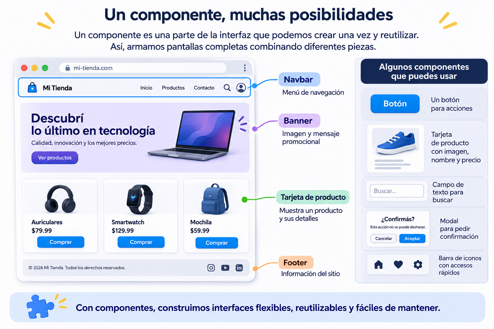

# Entendiendo la arquitectura web: de la SPA a un frontend bien organizado

Al terminar este módulo vas a poder explicar cómo funciona una aplicación web moderna por dentro, construir una pequeña app con React y Next.js, y organizar tu código para que siga siendo entendible cuando crezca.

El recorrido tiene tres paradas, y cada una se apoya en la anterior:

1. **SPA Architecture & Bundling:** cómo se arma y se entrega una app.
2. **Introduction to React and Next.js:** con qué herramientas la construimos.
3. **Organizing My Frontend:** cómo la mantenemos sana a medida que crece.

> **Idea guía:** primero entiendes el mapa (arquitectura), después aprendes las herramientas (React/Next.js), y al final aprendes el orden (organización). Mapa → herramientas → orden.

## SPA Architecture & Bundling

Cuando haces clic en un enlace de una aplicación como Gmail o Trello, ¿la página completa vuelve a cargarse? ¿O solamente cambia una parte de lo que estás viendo?. Para entenderlo, primero necesitamos conocer dos formas muy conocidas de organizar la navegación de una aplicación web: **MPA (Multi-Page Application)** y **SPA (Single-Page Application)**.

### La analogía: entrar a distintas oficinas de un edificio
Imagina que estás en un edificio y necesitas visitar distintas oficinas: recepción, administración y recursos humanos.

- MPA (Multi-Page Application): cada oficina está en un edificio diferente. Para ir de recepción a administración, tienes que salir, desplazarte a otro edificio y volver a entrar. En una web, el navegador solicita un documento HTML nuevo al servidor y reemplaza la página anterior.

- SPA (Single-Page Application): todas las oficinas están dentro del mismo edificio. Puedes pasar de recepción a administración sin salir del edificio. Solo cambia el espacio en el que estás, mientras la estructura general permanece. En una web, JavaScript actualiza el contenido de la interfaz sin solicitar un documento HTML completo cada vez que navegas.


**¿Por qué importa esta diferencia?**

Las MPA son habituales en blogs, portales de noticias, sitios institucionales y tiendas online, donde el contenido se organiza en páginas independientes. Las SPA son frecuentes en aplicaciones como Gmail, Trello y dashboards, donde los usuarios interactúan constantemente con la interfaz y necesitan una navegación más fluida.

Ninguna es mejor en todos los casos. La elección depende del tipo de aplicación y de la experiencia que queremos ofrecer.

### ¿Y qué es el bundling?

Durante el desarrollo, nuestra aplicación puede estar organizada en decenas o cientos de archivos: componentes, estilos, funciones y librerías. El navegador necesita recibir el código necesario para ejecutar la aplicación, pero no sería eficiente entregar cada módulo de forma desorganizada.

Aquí entra en juego un **bundler**. Podemos imaginarlo como alguien que prepara las cajas de una mudanza: reúne los objetos, los organiza y decide cómo distribuirlos para transportarlos de manera eficiente.

Entre sus principales tareas encontramos:

- **Bundling:** agrupa módulos relacionados en archivos de salida llamados *bundles*.
- **Minification:** elimina caracteres innecesarios del código para reducir su tamaño.
- **Tree shaking:** elimina código que no se utiliza, cuando puede determinarlo de forma segura.
- **Code splitting:** divide el código en diferentes paquetes para cargar solamente lo necesario en cada momento.

Herramientas como Vite y webpack realizan estas tareas. Next.js también incorpora herramientas de construcción y optimización para aplicaciones React.

**Para recordar:** SPA y MPA describen dos formas de organizar la navegación de una aplicación web. Bundling, en cambio, es el proceso de preparar y organizar el código para que el navegador pueda ejecutarlo.


## Introduction to React and Next.js

Imagina que estás construyendo una tienda online con 20 productos. Cada tarjeta muestra una imagen, un nombre, un precio y un botón para comprar. ¿Escribirías el mismo HTML 20 veces, cambiando únicamente los datos?

Para evitar repetir código y facilitar su mantenimiento, React propone construir interfaces a partir de piezas reutilizables llamadas **componentes**.

### React: construir interfaces con piezas

Un componente es una parte de la interfaz que podemos crear una vez y utilizar tantas veces como necesitemos. Piensa en las piezas de LEGO: podemos combinarlas de distintas maneras para construir algo más grande.

Un botón puede ser un componente, una tarjeta de producto puede combinar varios componentes y una pantalla completa puede estar formada por muchas de estas piezas.

Hay tres conceptos fundamentales:

| Concepto | Qué significa | Analogía |
|---|---|---|
| Componente | Pieza reutilizable de la interfaz. | Una pieza de LEGO. |
| Props | Datos que recibe un componente desde afuera. | Información para personalizarlo. |
| Estado (state) | Información que puede cambiar mientras utilizamos el componente. | La memoria del componente. |

Veamos un ejemplo:

```tsx
function ProductCard({ name, price }: { name: string; price: number }) {
  return (
    <article>
      <h3>{name}</h3>
      <p>${price}</p>
    </article>
  );
}
```

Este componente define la estructura de una tarjeta. Las propiedades `name` y `price` permiten mostrar productos diferentes sin escribir nuevamente el HTML.

```tsx
<ProductCard name="Teclado" price={50} />
<ProductCard name="Mouse" price={25} />
<ProductCard name="Monitor" price={200} />
```

La estructura se mantiene, pero el contenido cambia. Así construimos interfaces reutilizables y más fáciles de mantener.



### Next.js: más herramientas para construir aplicaciones web

React nos permite construir interfaces, pero una aplicación también necesita organizar sus páginas, gestionar la navegación y entregar el contenido al navegador. Para resolver estas necesidades existe **Next.js**, un framework basado en React que incorpora herramientas y convenciones para construir aplicaciones web completas.

Entre sus principales características encontramos:

- **Rutas por carpetas:** la estructura de archivos define las URLs. Por ejemplo, `app/products/page.tsx` corresponde a la ruta `/products`.
- **Renderizado en el servidor:** permite generar HTML antes de enviarlo al navegador, lo que puede mejorar la carga inicial y facilitar la indexación en buscadores.
- **Optimización integrada:** incorpora herramientas para optimizar imágenes, dividir el código y preparar la aplicación para producción.

**Conexión con el concepto anterior:** aprendimos que un bundler organiza y prepara los archivos de nuestro proyecto. Next.js incorpora herramientas de construcción que realizan parte de este trabajo por nosotros, sin necesidad de configurar cada detalle manualmente.

### Mini-práctica

1. Crea un componente `ProductCard` que reciba un nombre y un precio mediante props.
2. Utilízalo tres veces con productos diferentes.
3. Crea una segunda ruta en Next.js y navega entre ambas páginas.

El objetivo es comprender cómo React permite reutilizar componentes y cómo Next.js ayuda a organizar una aplicación web.

## Organizing My Frontend

Imagina volver a tu proyecto dentro de tres meses. ¿Cómo sabrías dónde está el código del carrito de compras?

### La analogía: una cocina ordenada

Una cocina profesional funciona porque cada cosa tiene su lugar: los cuchillos juntos, las especias etiquetadas, las ollas a mano. Con el código pasa lo mismo: si ordenas desde el principio, cocinas más rápido y con menos errores.

### Principios para organizar

1. **Una responsabilidad por pieza.** Un componente hace una cosa y la hace bien.
2. **Agrupa por cercanía.** Lo que cambia junto, vive junto.
3. **Nombres que se explican solos.** `ProductCard` dice más que `Box2`.
4. **Separa lo reutilizable de lo específico.** Un botón genérico no debería saber nada del carrito.

### Una estructura de ejemplo

```text
src/
├── app/            → páginas y rutas (Next.js)
├── components/     → piezas reutilizables (Button, Card)
├── features/       → lógica por funcionalidad (cart, auth)
├── lib/            → utilidades y funciones auxiliares
└── styles/         → estilos globales
```

No es la única estructura válida. Lo importante es que todo el equipo —y tu yo del futuro— pueda predecir dónde está cada cosa.

### Mini-práctica

1. Toma el proyecto de la práctica anterior.
2. Mueve `ProductCard` a una carpeta `components/`.
3. Crea una carpeta para una funcionalidad y justifica en una frase por qué pusiste cada archivo donde lo pusiste.

### Para recordar

- Organizar no es decorar: es reducir el esfuerzo de entender.
- Una buena estructura se nota cuando el proyecto crece y sigue siendo fácil.